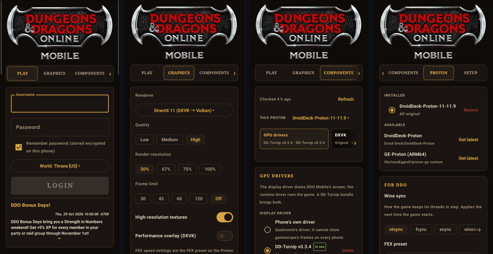
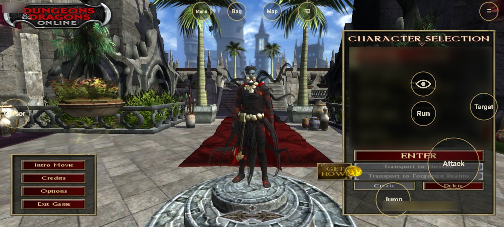
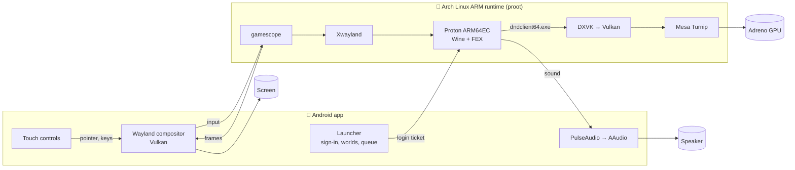
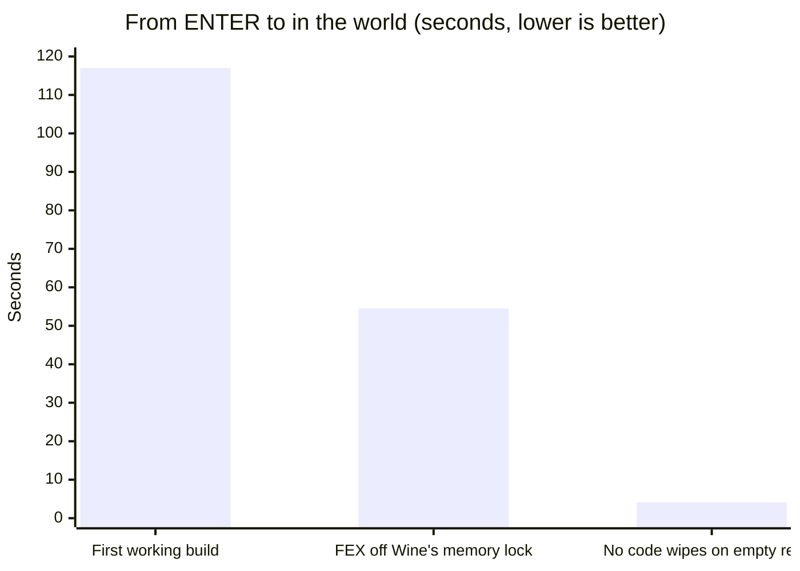
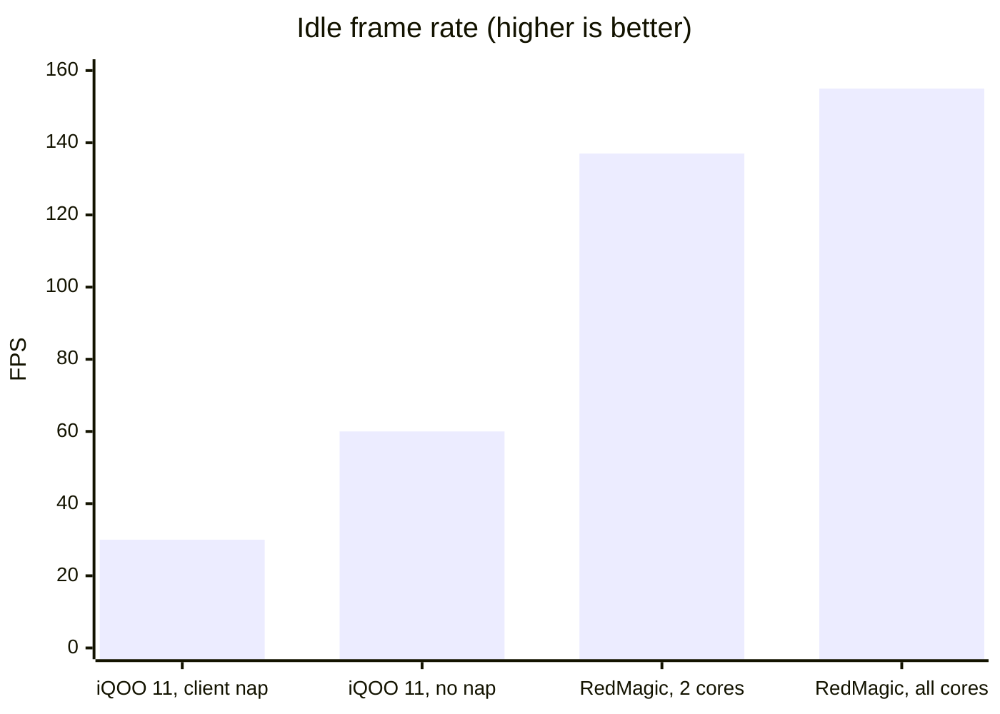
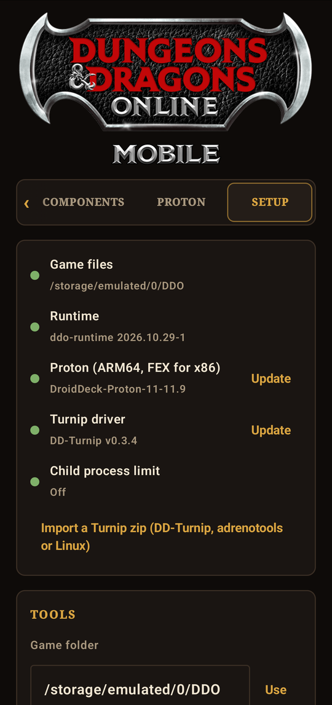
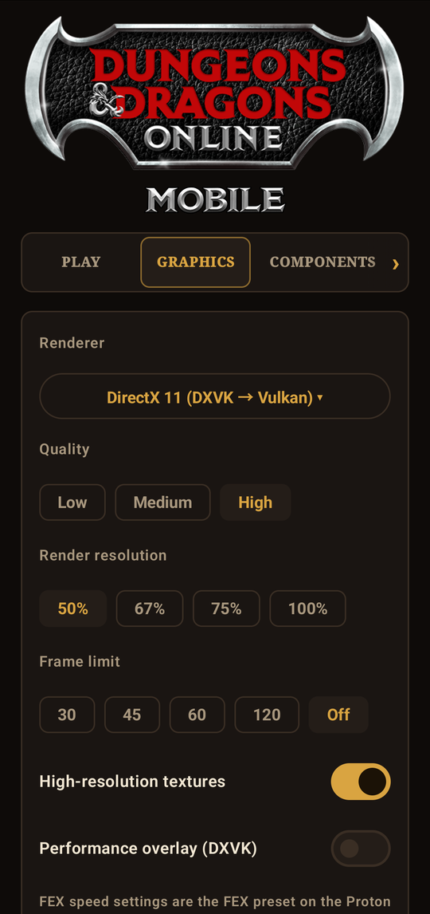
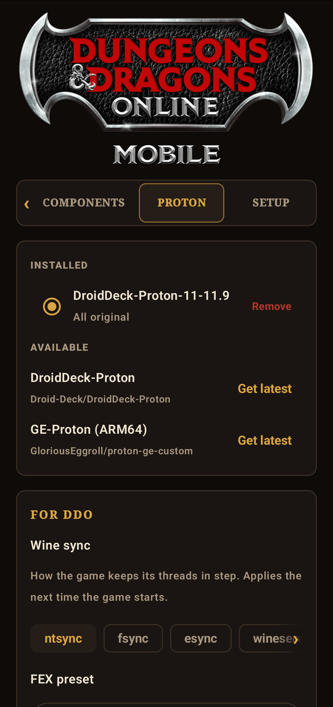

<div align="center">


<br>


### Dungeons & Dragons Online on your Android phone: the real Windows client, in your hand.

[](https://github.com/K11MCH1/DDO-Mobile/releases/latest)
[](LICENSE)
[](#-setup)
[](#requirements)



</div>

---

## 📜 What it is

**DDO Mobile** is an Android app that runs the **unmodified 64-bit Windows client** of Dungeons & Dragons Online on
ARM64 phones with a Snapdragon (Adreno) GPU. There is no streaming and no remote PC. The game runs on the phone
itself, through an ARM64 build of Proton with FEX translating the x86 code, and renders with DXVK on Mesa's Turnip
Vulkan driver.

It is a complete app: a launcher that signs you in to DDO, a game screen built for touch, and the plumbing in
between.

<div align="center">

<sub>Character selection on a RedMagic 11 Pro, with the touch controls over the game. Character names are blurred.</sub>
</div>

| | Feature | What you get |
|:-:|---|---|
| 🔐 | **Official sign-in** | Logs in through DDO's own login service, lists the worlds with their status and waits in the login queue, like the Windows launcher. The password can be remembered, sealed with a key that never leaves the Android Keystore. |
| 📰 | **News** | The official launcher's news feed, right under the login. |
| 🎮 | **Touch controls** | Tap to interact, drag to steer, a floating move stick, Attack that aims as it swings, an Eye button that orbits the camera, two-finger zoom and scroll, and buttons you can move anywhere. |
| 🖼️ | **Graphics** | DirectX 11, 10 or 9 (all through DXVK), quality presets, render resolution from 50% to 100%, frame limit up to uncapped, the panel's fastest refresh rate (up to 144 Hz). |
| 🧩 | **Components** | Fetch, install, swap and remove DXVK, VKD3D, Turnip and FEX builds, stable or nightly, without touching the Proton download. |
| 🍷 | **Proton** | Pick the Proton version, the Wine sync method (ntsync, fsync, esync, wineserver), a FEX speed preset, Force SSBS and extra game environment variables. |
| 🔊 | **Sound** | Wine's PulseAudio output goes to an Android-side PulseAudio that plays through AAudio. |

---

## 🛠️ How it works



- **The launcher** talks to DDO's login service, gets a session ticket for the chosen world and hands it to the game.
  The ticket only ever travels in a private file, never on a command line or in a log.
- **The runtime** is a small Arch Linux ARM userspace (about 660 MB unpacked), built from the official, signature-checked
  packages, with a few shims for what Android hides from apps. It runs under proot with DroidDeck's in-process fast
  path.
- **Proton** (DroidDeck-Proton by default) runs the Windows client as an ARM64EC process. Wine's own code runs
  natively on ARM, and only the game's x86-64 code goes through FEX.
- **gamescope** gives the game a fullscreen X display and hands finished frames to the app's own single-client
  Wayland compositor. The compositor shows them on the phone's screen without copying them.
- **Turnip** drives the Adreno GPU for the game, and DXVK turns DirectX into Vulkan.

---

## 🚀 How we did it

The first run reached the loading screen after many minutes. Most of the work since then has been finding where
the time went and taking it back. Each fix below was measured on a phone, in the game.





| Fix | Problem | Result |
|---|---|---|
| **FEX: no code wipes on empty reads** | After every successful file read FEX invalidates translated code in the buffer. A zero-length read with no buffer, which is how programs poll a pipe or a socket, meant "the whole process". DDO does that thousands of times, so every few milliseconds every thread lost all of its translated code. | Into the world in **4.1 s instead of 50 s**; full code-cache wipes went from up to 7 per 5 s to none; the play stutters stopped |
| **FEX: off Wine's memory lock** | Zeroing memory, the allocator, instruction-cache flushes and code-range lookups each went through Wine's global virtual memory lock. | World load **117 s → 54.5 s**; lock waits during a load **4127 → 129** samples |
| **Timer from the CPU** | Every `QueryPerformanceCounter` call was a system call under ARM64EC, and DDO makes hundreds of thousands a second while loading. It now reads the CPU's generic timer directly, as Windows on Snapdragon does. | Clock reads went from **5.1% to 0.06%** of the game thread |
| **Cached GPU memory** | Turnip mapped CPU-readable GPU memory uncached, and DDO's graphics start-up read it on the CPU for minutes. | Start-up back to normal |
| **No client nap** | DDO sleeps every frame according to its engine-speed setting. On top of translated frames that held the world at about 30 fps. | About **30 → 60 fps** idle |
| **Every core** | Phones without a little cluster were left with two cores for the game. | **137 → 155 fps** idle on the RedMagic 11 Pro |
| **FEX speed presets** | DDO's executable has no volatile metadata, so FEX ordered every memory access (TSO). | The main thread no longer spends most of its time on memory ordering |
| **Larger audio periods** | Short PulseAudio periods kept about 40% of a core busy. | Sound for a fraction of the cost |
| **Panel refresh** | Android dropped to 60 Hz when left alone, and a jittered measurement once announced 240 Hz on a 144 Hz panel. | The panel's fastest mode, never more |

The FEX and timer fixes live in [`runtime/fex/`](runtime/fex) and [`ddo-run`](runtime/overlay/usr/local/bin/ddo-run).
The [branches below](#-branches) package them for other projects.

---

## 📦 Setup

### Requirements

| | |
|---|---|
| **Phone** | ARM64 Android phone with a **Snapdragon (Adreno)** GPU. Tested on the RedMagic 11 Pro (Snapdragon 8 Elite Gen 5, Adreno 840) and the iQOO 11 (Snapdragon 8 Gen 2, Adreno 740). |
| **Android** | 9 or newer |
| **Storage** | A few GB for the runtime, Proton, drivers and the game's Windows prefix, plus the size of your DDO folder |
| **Game files** | Your own DDO installation from a Windows PC |
| **Account** | A Dungeons & Dragons Online account |
| **Network** | Wi-Fi recommended for the first setup (Proton is about 600 MB) |

### Steps

1. **Install the app.** Download `DDO-Mobile-0.1.0.apk` from the [latest release](https://github.com/K11MCH1/DDO-Mobile/releases/latest)
   and install it. Your browser or file manager may ask to allow installing apps.
2. **Get the runtime.** Download `ddo-runtime-2026.10.31-1.tar.zst` from the same release into the phone's
   **Download** folder. Leave it there; the app finds it on its own.
3. **Copy the game.** Copy your whole DDO installation folder from the PC to the phone as **`DDO`** in internal
   storage, so that `/storage/emulated/0/DDO/client_general.dat` and `/storage/emulated/0/DDO/x64/dndclient64.exe`
   exist. Over USB with adb that is:

   ```bash
   adb push "C:\Program Files (x86)\StandingStoneGames\Dungeons & Dragons Online" /sdcard/DDO
   ```

4. **Open DDO Mobile** and allow **access to all files** when asked, so it can read the game folder.
5. **Set up.** On the **Setup** tab, tap **Set up everything**. It installs the runtime, downloads Proton and the
   Turnip driver, and ticks each line when it's done.
6. **Child process limit.** If that line isn't ticked, turn on **Disable child process restrictions** in Developer
   options, or run:

   ```bash
   adb shell settings put global settings_enable_monitor_phantom_procs false
   ```

7. **Play.** On the **Play** tab, enter your username and password, pick a world and tap **LOGIN**.

<div align="center">
&nbsp;
&nbsp;

</div>

> [!TIP]
> Start with the defaults. If the game ever freezes, set the FEX preset on the **Proton** tab back to **Performance**,
> or **Performance + TSO**. The Extreme presets turn off safety checks that some games rely on.

---

## 🎮 Touch controls

The game's own cursor is hidden: your finger is the cursor. In the world, a tap selects and interacts. It never
attacks; Attack is a button.

### Gestures

| Gesture | Where | What it does |
|---|---|---|
| 👆 **Tap** | Anywhere | Clicks there: selects and interacts in the world (talk, open, pick up), or clicks a window or ability |
| ✋ **Drag** | Free screen | Turns the camera and your character (DDO's right-button steer) |
| ⏱️ **Long press** | Anywhere | Right click |
| ⏱️➡️ **Long press, then drag** | Windows | Drags with the left button, to move items |
| 🕹️ **Slide** | Lower left | A move stick appears under your thumb: forward and back, strafe left and right |
| ✌️ **Two-finger tap** | Free screen | Right click |
| 🤏 **Pinch or spread** | Free screen | Zooms the camera |
| ✌️↕️ **Two-finger slide** | Lists, chat, windows | Scrolls what is under your fingers |

### Buttons

| Button | What it does |
|---|---|
| **Attack** | Attacks while held. Slide your thumb on it to aim the camera as you swing |
| **Eye** (above Run) | Hold and slide to swing the camera around your character without turning them |
| **Jump** | Jump |
| **Run** | Auto-run: keeps running forward until you tap it again |
| **Target** | Selects the next enemy |
| **Cursor** (left edge) | Shows the game's cursor and turns the free screen into a trackpad; filled while on |
| **Menu · Bag · Map** | Esc, inventory and map |
| **⌨** | Opens or closes the phone's keyboard |
| **✥** (arrows, top right) | **Rearrange the buttons**: they turn green and follow your finger, and nothing reaches the game. Tap it again to save the layout |
| **☰** | Hide the touch controls, hide the FPS counter, keyboard, quit the game |

> [!NOTE]
> Log out in the game before you quit from the **☰** menu, to keep your character safe. Quit closes the game and
> everything under it, and brings you back to the launcher.

---

## 🌿 Branches

Three branches hold fixes from DDO Mobile on their own, laid out for **DroidDeck** to take. They don't depend on the
rest of this repository.

| Branch | What it holds | Goes into |
|---|---|---|
| [`FEX-patches`](https://github.com/K11MCH1/DDO-Mobile/tree/FEX-patches) | The FEX fixes as patches for DroidDeck-Proton's FEX series | `Droid-Deck/DroidDeck-Proton`, `patches/fex/` |
| [`Timer-fixes`](https://github.com/K11MCH1/DDO-Mobile/tree/Timer-fixes) | `QueryPerformanceCounter` from the CPU timer for ARM64EC | DroidDeck's Proton launch |
| [`turnip-memory-setting`](https://github.com/K11MCH1/DDO-Mobile/tree/turnip-memory-setting) | Cached CPU-readable GPU memory for Turnip | DroidDeck's game environment |

---

## 🧱 Building from source

| Part | How |
|---|---|
| **App** | `./gradlew assembleRelease` (Android SDK and NDK; the APK lands in `app/build/outputs/apk/release/`) |
| **Runtime** | `runtime/build.sh OUTDIR VERSION` on any aarch64 Arch Linux ARM system, or `runtime/tools/build-on-phone.sh VERSION` to use a phone over adb |
| **FEX** | `runtime/fex/build.sh` on Windows (Git Bash) or Linux; the runtime build puts the result in the image |

---

## 🙏 Credits

DDO Mobile stands on the work of many projects. See [NOTICE.md](NOTICE.md) for exactly what came from where.

| Project | Used for | License |
|---|---|---|
| [DroidDeck](https://github.com/Droid-Deck/DroidDeck) | The compositor, runtime shims, proot fast path, PulseAudio build, session design, Components and Proton tabs | GPL-3.0 |
| [DroidDeck-Proton](https://github.com/Droid-Deck/DroidDeck-Proton) | The default Proton, and the FEX patch series ours builds on | Various (Wine: LGPL-2.1) |
| [DD-Turnip / Drivers-CI](https://github.com/Droid-Deck/Drivers-CI) | The default Turnip driver | MIT |
| [FEX-Emu](https://github.com/FEX-Emu/FEX) | x86-64 translation | MIT |
| [Proton](https://github.com/ValveSoftware/Proton) and [Wine](https://www.winehq.org) | Windows compatibility | Various, LGPL-2.1 |
| [DXVK](https://github.com/doitsujin/dxvk) and [VKD3D-Proton](https://github.com/HansKristian-Work/vkd3d-proton) | DirectX on Vulkan | zlib, LGPL-2.1 |
| [Mesa](https://mesa3d.org) (Turnip) | The Adreno Vulkan driver | MIT |
| [gamescope](https://github.com/ValveSoftware/gamescope) | The game's display | BSD-2-Clause |
| [PRoot](https://proot-me.github.io) | Running the Linux userspace | GPL-2.0 |
| [PulseAudio](https://www.freedesktop.org/wiki/Software/PulseAudio/) | Sound | LGPL-2.1 |
| [libadrenotools](https://github.com/bylaws/libadrenotools) | Loading custom Adreno drivers | BSD-2-Clause |
| [OneLauncher](https://github.com/JuneStepp/OneLauncher) | The model for the sign-in, world and queue flow | GPL-3.0 |
| [Arch Linux ARM](https://archlinuxarm.org) | The runtime's packages | Various |
| [The412Banner](https://github.com/The412Banner) and [WinNative](https://github.com/WinNative-Emu) | Component and driver builds in the catalogs | Various |

---

## ⚖️ License and disclaimer

DDO Mobile is free software under the [GNU General Public License v3.0](LICENSE).

DDO Mobile is an unofficial fan project. It is not affiliated with, endorsed by or supported by Standing Stone Games,
Daybreak Game Company or Wizards of the Coast. Dungeons & Dragons Online, Dungeons & Dragons and their logos are
trademarks of their respective owners. DDO Mobile includes no game files: you need your own installation and
account.
